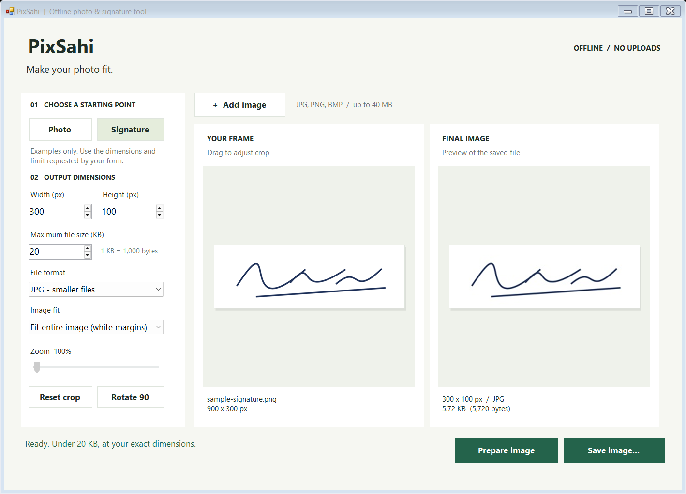

<div align="center">

# PixSahi

**Make your photo fit.**

An offline Windows app to prepare photos and signatures for online forms.

[](https://github.com/kartikvermagit-ds/pixsahi/releases/latest/download/PixSahi.exe)
[](https://github.com/kartikvermagit-ds/pixsahi/releases/latest)
[](https://github.com/kartikvermagit-ds/pixsahi/actions/workflows/build.yml)
[](LICENSE)

[Download ZIP](https://github.com/kartikvermagit-ds/pixsahi/releases/latest/download/PixSahi-Windows.zip) · [Hindi guide](docs/README.hi.md) · [Report a bug](https://github.com/kartikvermagit-ds/pixsahi/issues/new?template=bug_report.yml)



*Real app interface with a synthetic demonstration signature.*

</div>

A form asks for a particular width, height, and file-size limit. PixSahi lets you enter those requirements, frame your image, and save a file that fits—without uploading your photo or signature to a website.

## Download and get started

1. **[Download PixSahi.exe](https://github.com/kartikvermagit-ds/pixsahi/releases/latest/download/PixSahi.exe)** and open it. No installer or administrator access is required.
2. Click **Add image**, drag one image into the window, or press **Ctrl+O**.
3. Choose **Photo** or **Signature**, then enter the dimensions and maximum KB from your form.
4. Adjust the crop or choose **Fit entire image** to keep everything visible.
5. Click **Prepare image**, inspect the final preview and size, then **Save image**.

Prefer a package? [Download the Windows ZIP](https://github.com/kartikvermagit-ds/pixsahi/releases/latest/download/PixSahi-Windows.zip), extract it, and open `PixSahi.exe`. GitHub's **Code → Download ZIP** contains source code; use these release links for the ready-to-run app.

Designed for Windows 10/11 with .NET Framework 4.5 or later. Python, Node.js, and the .NET SDK are not needed to run it. This release is an unsigned executable; Windows may display an unknown-publisher warning. Release assets include SHA-256 checksums.

## What it does

| Feature | How it helps |
| --- | --- |
| Exact pixel dimensions | Enter the required width and height |
| Maximum file size | JPG quality adjusts to fit your KB limit without silently changing dimensions |
| Crop, zoom, and rotate | Frame a photo using the draggable left preview |
| Fit with white margins | Keep the entire signature or image visible |
| Actual output preview | The right preview is decoded from the exact bytes that will be saved |
| JPG and PNG output | Choose smaller JPEG files or lossless PNG encoding after resizing |
| Phone photo orientation | Applies EXIF orientation before processing |
| Original protection | Saving to the original path is blocked |
| Offline processing | No accounts, uploads, telemetry, or app network requests |

## Limits that matter

- **Presets are examples, not official portal requirements.** Check your form's current rules for dimensions, format, background, framing, DPI, and minimum file size. PixSahi does not guarantee portal acceptance.
- File sizes use **1 KB = 1,000 bytes**. The preview also shows the exact byte count.
- This version enforces a **maximum** file size. It does not pad images to meet a minimum.
- PNG can be too large at the requested dimensions. In that case, the app asks you to use JPG, raise the limit, or reduce the dimensions.
- If even low-quality JPG cannot meet your limit, the app reports the problem rather than saving an oversized file. Inspect readability when strong compression is needed.
- Transparency is flattened onto white. Fit mode adds white margins; it does not remove an existing background.
- Dimensions are in pixels. Output resolution metadata is 96 DPI; custom DPI is not available in this version.

| Input | Output |
| --- | --- |
| JPG/JPEG, PNG, BMP | JPG/JPEG or PNG |
| Up to 40 MB and 40 megapixels; at most 20,000 px per side | 16–4,000 px per side |
| One image at a time | Maximum-size setting: 1–20,000 KB |

HEIC, WebP, GIF, TIFF, and PDF input are not supported yet.

## Privacy and uninstalling

Images are processed on your PC. Source files are not edited. The output is redrawn without copying source EXIF/GPS metadata. Saving over a different existing output uses Windows' overwrite confirmation.

PixSahi creates no startup entry, background service, or registry preferences. To uninstall, close the app and delete its folder. Files you exported stay where you saved them.

## Build from source

On Windows, run from this repository in PowerShell:

```powershell
.\scripts\build.ps1 -Test -Package
```

The script uses the Windows .NET Framework compiler, builds `dist/PixSahi.exe`, runs checks with generated test images, and packages the app and checksums. It does not use personal photos. See [CONTRIBUTING.md](CONTRIBUTING.md) for details.

Checks cover output dimensions and byte limits, JPEG compression, PNG rejection when oversized, crop/fit behavior, transparency, all eight EXIF orientations, original-file protection, exact saved bytes, and invalidation of stale previews. Windows file dialogs, mixed-DPI displays, and real portal acceptance still need manual verification on the target setup.

## Feedback

[Report a bug](https://github.com/kartikvermagit-ds/pixsahi/issues/new?template=bug_report.yml) or [suggest an improvement](https://github.com/kartikvermagit-ds/pixsahi/issues/new?template=feature_request.yml). Include the requested dimensions, KB limit, output format, and Windows display scaling. Please do not post personal photos, signatures, or documents in public issues; a synthetic sample is better.

If PixSahi helps you finish a form, a star helps other people find it.

Released under the [MIT License](LICENSE).
